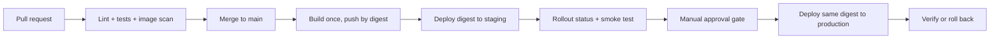

# EKS delivery pipeline

A CI/CD delivery pipeline for a small Flask service, built one phase at a time —
from a first `pull_request` trigger through to a rolling deployment on Amazon EKS.

This is a **build log, not a showcase.** Every workflow, chart, and Terraform
module here is written by hand, pushed, broken on purpose, debugged from the run
logs, and only then kept. The commit history is the point: small commits, real
failures, and a recorded root cause for each one in
[`LEARNING_LOG.md`](LEARNING_LOG.md).

## Application under delivery

A deliberately boring Flask service — the interesting engineering is the pipeline
around it, not the app itself.

| Endpoint   | Purpose                                   |
|------------|-------------------------------------------|
| `/`        | Service name, environment, version         |
| `/healthz` | Liveness — is the process alive?           |
| `/readyz`  | Readiness — should it receive traffic?     |

```bash
make setup      # virtualenv + dev dependencies
make verify     # ruff + pytest
make run        # serve on :8080
make smoke      # hit /healthz against a running instance
```

## Target architecture



The same image digest is promoted through every environment. Nothing is rebuilt
between staging and production.

## Build phases

| # | Phase | Runs on |
|---|-------|---------|
| 01 | Pull-request CI — lint and tests | GitHub-hosted runner |
| 02 | Multi-stage image build, push tagged by commit SHA | GHCR |
| 03 | Job outputs, artifacts, dependency caching | GitHub-hosted runner |
| 04 | Environments, approval gates, concurrency locks | GitHub-hosted runner |
| 05 | Deploy to Kubernetes with rollout gating and rollback | kind |
| 06 | Helm chart with per-environment values | kind |
| 07 | Argo CD — pull-based GitOps reconciliation | kind |
| 08 | Observability — Loki, Tempo, Prometheus, Grafana | kind |
| 09 | Terraform: remote state, modules, plan-on-PR / apply-on-merge | AWS (plan only) |
| 10 | Live EKS — apply, deploy, verify, destroy | AWS |

Phases 1–9 cost nothing. Everything runs on GitHub-hosted runners and a local
`kind` cluster. AWS is used deliberately and briefly in phase 10, then destroyed.

## Repository layout

```
app/            Flask application
tests/          pytest suite
deploy/k8s/     Kubernetes manifests
docs/           cost guardrails, production scorecard
exercises/      the phase briefs I work through
LEARNING_LOG.md root cause for every failure I caused
```

## Definition of done

I can rebuild the pipeline from a blank file, diagnose a failed run from its logs
alone, explain every permission, trigger, cache key and gate, and deploy and roll
back without notes.
